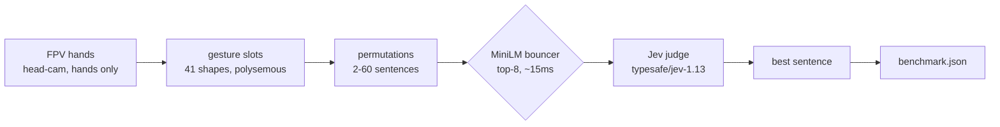

# jev_sentence_builder

Hands → gesture slots → sentence permutations → MiniLM filter → Jev picks one.



## Pieces

| Part | What | Size |
|---|---|---|
| `dataset.json` | 41 hand shapes + readings (`shape`, `meanings`) | ~8 KB |
| `test.json` | 31 tests, L1/L2/L3 + `accept` lists | ~15 KB |
| MiniLM filter | `cross-encoder/ms-marco-MiniLM-L-6-v2`, 22M params, top-K=8 | ~90 MB, ~15ms, local |
| Jev judge | `typesafe/jev-1.13` via OpenRouter Decisions API | ~500-1200ms/call |
| `script.py` | stdlib only, parallel calls | ~12 KB |

## Run

```bash
python script.py --dry-run   # validate, no API
OPENROUTER_API_KEY=xxx python script.py   # live → benchmark-results/latest.json
```

## Benchmark

Coming after live runs: accuracy overall + per level (L1/L2/L3), p50/p95 latency, filter recall (did MiniLM keep the answer?), MiniLM-vs-Jev head-to-head.
